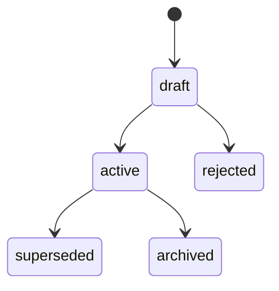

# Concepts

## Document types

| type     | key       | what it is                                                     |
| -------- | --------- | -------------------------------------------------------------- |
| sot      | slug      | a source of truth: the rule that holds now                     |
| adr      | timestamp | a decision and the reason for it                               |
| plan     | timestamp | a plan of work and its running record                          |
| research | timestamp | a study, benchmark or evaluation                               |
| evidence | timestamp | the cover of a bundle of measurements or raw outputs           |
| audit    | timestamp | an audit snapshot; its body is sealed once committed           |
| page     | slug      | the specification of one screen or page                        |
| design   | timestamp | a bundle of design boards                                      |
| guide    | slug      | how to develop, operate or use something                       |
| runbook  | slug      | a step-by-step operational procedure                           |

Projects can disable, change or add types in `spec.toml`. `spec schema <type>` prints a type's
frontmatter.

## Owners and ids

Each owner (the repository root, an app, a package) keeps its documents in its own `.spec/`.
Owners are found through package manifests or `[owners]` patterns in `spec.toml`.

Ids are `<type>:<owner>/<key>`, computed from where a document lives. Files are
`<owner>/.spec/<type>/<key>-<slug>.<type>.md`, or a directory with `index.<type>.md` when the
document has chapters or attachments.

## Times

Timestamp keys (`YYYYMMDDHHMMSS`) are UTC. specfold writes `created` and `updated` as RFC 3339
times in UTC (`2026-10-30T02:21:00Z`). It reads plain `YYYY-MM-DD` dates, any RFC 3339 offset
(`2026-10-30T11:21:00+09:00`) and, as a reading aid only, `2026-10-30 11:21 KST` (only UTC,
GMT, KST and JST; ambiguous names such as CST are refused). Times are compared by their UTC day.

## Statuses and relations

Statuses are `draft`, `active`, `superseded`, `archived` and `rejected`, and only move forward.

A type can set its own `transitions` in `spec.toml`.

Relations are written once, on the document that makes them: `rel.governs` (code paths),
`rel.supersedes`, `rel.implements`, `rel.evidence`, `rel.depends_on`. Body references are
`[[<id>]]` or `[[<id>#<anchor>]]`. The graph is derived from these on every run.

## Task items

Task items (`- [ ]`, `- [x]`) are counted: `spec show` reports a document's progress and
`spec show <id> --tasks` lists each item with its file and line.
