# Checks

> [!TIP]
> `spec check` runs the rules and reports each finding by rule id with a fix. Guards scan any
> file, plugins add rules, and `spec audit` finds what passes yet needs attention.

## How a check runs



*How a check runs. Source: [checks.mmd](../assets/diagrams/checks.mmd).*

## Run the rules

```console
$ spec check --staged     # before committing
$ spec check --new        # documents not in the last commit
$ spec check --summary    # findings per rule; -q lists errors only
```

`spec explain <rule>` says why a rule exists and how to fix it. The full list is in
[Rules](../reference/rules.md).

## Unknown keys

A front matter key outside the common set and the type's fields is a warning (**S1**). Keep a
key for one type with `[types.<type>] fields = [...]`, or for every type with
`[check] extra_keys = ["team", "review_*"]`.

## Numbers that stay true

A number in prose can name its source, and `spec check` warns when it drifts (**N1**).
`spec fix --write` rewrites it. Sources are spec's own counts, never shell commands.

```md
We keep <!-- spec:count find type=adr status=active -->12<!-- /spec:count --> active decisions.
```

## Guards, plugins and audits

- **Guards** (`[[guards]]`, `spec guard`) check files and commit messages for denied terms,
  patterns, files, sizes and secrets. Terms can come from an environment variable and are masked.
- **Plugins** (`[[plugins]]`) speak `specfold.plugin.v1` JSON over stdin and stdout. Only
  programs named in `spec.toml` run. Exporters can ask for bodies and resolved links; see
  [Exporting to Markdown](../guides/export.md).
- **Audits** (`spec audit`) report stale documents, orphans, stalled plans and drifted agent
  assets. `spec audit record` seals a review as an `audit` document.

Pin a document to a commit with `spec set <id> verified_at=HEAD`; `spec audit --kind stale` then
reports later commits to the governed paths.
