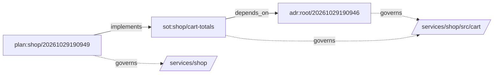

# The graph

> [!TIP]
> Relations are written once, on the document that makes them. specfold derives the graph on
> every run, so `spec context` can tell you which documents govern a file.

## Relations

| relation | points at | meaning |
| --- | --- | --- |
| `rel.governs` | code paths | this document rules that code |
| `rel.supersedes` | a document | this replaces an older one |
| `rel.implements` | a document | this carries out a plan or rule |
| `rel.evidence` | a document | this backs a claim with data |
| `rel.depends_on` | a document | this needs another to hold |

Body references are `[[<id>]]` or `[[<id>#<anchor>]]`. Rules **L1** and **L3** check that they
resolve and point at the right types.

## A small graph

A plan implements a source of truth, which depends on a decision. Dashed lines are code paths.
This block is the output of `spec graph --format mermaid` on the tutorial repository.

<!-- spec:graph format=mermaid source=tutorial -->



<!-- /spec:graph -->

## Ask the graph

```console
$ spec context services/shop/src/cart/total.rs
$ spec graph impact sot:shop/cart-totals
$ spec graph chain adr:root/20261029190946
$ spec graph consumers org:adr:root/20261030000000
```

`spec context` lists the documents to read before changing a path. `impact` lists what reaches a
document, with the relation and distance. `chain` shows a supersede chain in both directions. `consumers` lists the documents, in this
repository and in each `[remotes]` directory on disk, whose relations or pins name a document
through a remote. In a shared repository, list the consuming repositories as remotes and run it
before changing a shared decision; `--json` feeds a dashboard. Nothing is fetched.

## Draw it in a terminal

`spec graph` prints a tree from the documents nothing points at. A document already shown ends
in `(*)`, and `--depth N` stops N relations away.

```console
$ spec graph
sot:shop/cart-totals  [draft]
├─ depends_on → adr:root/20261029190946  [draft]
│  └─ governs → services/shop/src/cart
└─ governs → services/shop/src/cart
```

`--format box` draws layered boxes sized to `COLUMNS`, and falls back to the tree when the graph
is too wide or over 60 documents. `--format mermaid` and `--format dot` feed a Markdown renderer
or Graphviz. `--ascii` uses plain lines, chosen automatically outside UTF-8 locales.

Next: how the graph is kept honest, in [Checks](checks.md).
