# Lifecycle

> [!TIP]
> A document starts as `draft`, becomes `active`, and ends `superseded`, `archived` or
> `rejected`. Statuses only move forward, and `spec set` is the only way to change them.

## The flow



*Statuses only move forward. Source: [lifecycle.mmd](../assets/diagrams/lifecycle.mmd).*

## The statuses

| status | meaning |
| --- | --- |
| `draft` | being written; not binding yet |
| `active` | the document that holds now |
| `superseded` | replaced by exactly one successor |
| `archived` | no longer relevant, kept for history |
| `rejected` | a draft that was not accepted |

## Changing status

```console
$ spec set sot:shop/cart-totals status=active
$ spec set adr:root/20261030 rel.supersedes+=adr:root/20250101
```

`spec set` writes directly and accepts `--dry-run`. It refuses a jump the type does not allow, and
sealed or closed documents. Rule S6 then checks the fields the new status requires.

## What the rules check

- **T1**: a superseded document has exactly one successor.
- **T2**: status only moves forward, along the type's `transitions`.
- **T3**: sealed documents, such as a committed `audit`, keep their body.
- **T4**: an edited body moves its `updated` date.
- **S6**: a status has the fields it requires.

`spec log <id>` shows the history of a document's status and relations, read from git.

## Custom transitions

A type can set its own `transitions` (from → list of to) and `require_when` (status → required
keys) in `spec.toml`. `spec explain T2` prints the rule and how to fix a finding.

Next: where a document lives, in [Owners and ids](owners-ids.md).
