# Lifecycle

> [!TIP]
> A document starts as `draft`, becomes `active`, and ends `superseded`, `archived` or
> `rejected`. Statuses only move forward, and `spec set` is the only way to change them.

## The flow



*Statuses only move forward. Source: [lifecycle.mmd](../assets/diagrams/lifecycle.mmd).*

## The statuses

| status | meaning |
| --- | --- |
| `draft` | being written; not binding yet |
| `active` | the document that holds now |
| `superseded` | replaced by exactly one successor |
| `archived` | no longer relevant, kept for history |
| `rejected` | a draft that was not accepted |

## Changing status

```console
$ spec set sot:shop/cart-totals status=active --write
$ spec set adr:root/20261030 rel.supersedes+=adr:root/20250101 --write
```

`spec set` previews the change until `--write`, as `--dry-run` does. It refuses a jump the type does not allow, and
sealed or closed documents, and a second successor for a document something already supersedes
(`spec new --from` too): it names the one in force. It also refuses a status whose required fields
(`require_when`) the document does not have, and prints the command that sets them with the status;
rule S6 checks the same for documents edited by hand.

## Superseding

`spec new <type> --from <old>` writes `rel.supersedes` on the new document. The old document is
marked `superseded` when the new one takes effect:

- a type that starts `active` (research, guide, runbook) takes effect at once, so `spec new` marks
  the old document in the same write;
- a type that starts as a `draft` takes effect when `spec set <new> status=active --write` moves
  it on, and that write marks the old document too. Until then the old document stays in force
  and can still be edited; a draft that ends `rejected` leaves it as it is.

With its own lifecycle, a type takes effect at the first current status after its initial one
(`accepted` for draft, accepted, final). T1 asks for `superseded` only once a successor has taken
effect, so a pending draft is no finding.

```console
$ spec new adr --from adr:root/20250101 --title "Move orders to a queue" --write
$ spec set adr:root/20261030 status=active --write   # marks adr:root/20250101 superseded
```

## What the rules check

- **T1**: a superseded document has exactly one successor.
- **T2**: status only moves forward, along the type's `transitions`.
- **T3**: sealed documents, such as a committed `audit`, keep their body.
- **T4**: an edited body moves its `updated` date.
- **S6**: a status has the fields it requires.

`spec log <id>` shows the history of a document's status and relations, read from git.

## Custom transitions

A type can set its own `transitions` (from → list of to) and `require_when` (status → required
keys) in `spec.toml`. `spec explain T2` prints the rule and how to fix a finding.

Next: where a document lives, in [Owners and ids](owners-ids.md).
